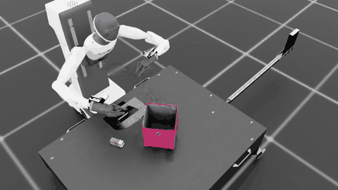
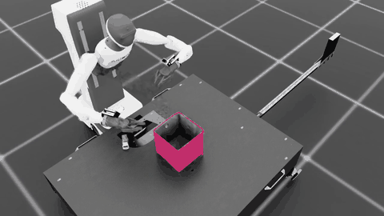

# 실습 과제 2: Agibot Toy2Box 모방학습 (자동 조종 시범 30개 → Mimic 500 → BC-RNN)

로보틱스 시뮬레이션 실습 과제 2(`Isaac-Place-Toy2Box-Agibot-Right-Arm-RmpFlow-v0`)의 첫 결과입니다.
수업 자료(Week08 슬라이드 42–45쪽, 참고자료 「모방학습 PDF v1.1」)의 파이프라인을 **조교 설정 그대로** 따라 했습니다.
바꾼 것은 시범을 만드는 방법 하나뿐입니다. 키보드 조작법을 그대로 흉내 내는 **스크립트 조종자**가 시범 30개를 모았습니다.

| 구분 | 조교 시연 (슬라이드 45쪽) | **이번 결과** |
| --- | --- | --- |
| 원본 시범 | 사람 키보드 시범 20개 | 스크립트 조종 시범 30개 (키보드와 같은 action 형식) |
| Mimic 증강 | 성공 500개 | 성공 500개 (1,086회 시도, 46.0%) |
| 학습 | BC-RNN low-dim, 2000 epoch, seed 101 | 같음 (`bc_rnn_low_dim.json` 수정 없음) |
| 평가 | 100 rollout, horizon 800, seed 42 | 같음 |
| **성공률** | **26 / 100** | **65 / 100** |
| 모델 | – | [`bc_rnn_auto30_mimic500_s101_epoch2000.pth`](models/bc_rnn_auto30_mimic500_s101_epoch2000.pth) |

> **주의: 과제 규칙과의 관계.** 과제 규칙은 "사람 시범 최대 100개 · 키보드로 직접 수집"입니다.
> 이 결과의 원본 30개는 사람이 아니라 스크립트가 조종했습니다. 그래서 최종 제출용 "사람 시범"으로 인정되는지는 조교 확인이 필요합니다.
> 지금은 **파이프라인 검증과 비교 조건**(사람 데이터 vs 일관된 자동 데이터)으로 쓰는 것을 전제로 정리했습니다.
> 또 학습 seed는 101 하나만 돌렸습니다. 과제 판정 규칙(seed 101 & 111 평균 ± 표준편차)은 아직 채우지 않았습니다.

## 1. 시범 수집: 스크립트가 키보드를 누른다

[`scripts/tools/record_demos_auto.py`](../../scripts/tools/record_demos_auto.py)는 `record_demos.py`와 같은 녹화 장치를 그대로 씁니다.
- `ActionStateRecorder`로 기록하고, 성공한 시범만 저장합니다(`EXPORT_SUCCEEDED_ONLY`).
- 성공 판정도 같습니다: 3조건이 10 step 연속 유지되면 저장합니다.

다른 점은 사람 대신 조종자 클래스가 **매 step 어떤 키를 누르고 있을지** 정한다는 것뿐입니다.
- action은 `Se3Keyboard.advance()`와 같은 식으로 만듭니다. 그래서 이동·회전은 키 하나당 ±0.05, 그리퍼는 +1(열림)/−1(닫힘)입니다.
- 회전 키 두 개를 동시에 누르면 실제 키보드처럼 ±0.0487 같은 값이 나옵니다.
- 조종자는 관측(손끝·트럭·상자의 위치와 자세)만 봅니다.

| 단계 | 누르는 키 | 슬라이드의 요령 |
| --- | --- | --- |
| 접근·정렬 | W/S·A/D로 트럭 위, T/G로 손을 아래로, C/V로 손가락을 트럭 옆면에 | 높은 곳에서 수평 이동 먼저 |
| 하강 | E | 위에서 x·y를 맞춘 뒤 내려간다 |
| 파지 | (멈춤 4–8 step) → K | 완전히 멈춘 뒤 K |
| 들기·운반 | Q로 상자 벽 위까지 → W/A… 로 트럭을 상자 중심 위에 | 벽보다 높이, 이동 중 회전 키 안 씀 |
| 배치 | E로 살짝 → K → 멈춘 채 대기 | 열고 0.5초 대기 |
| 버리기 | R | 트럭이 넘어짐, 놓침, 한 단계가 350 step 초과 |

시범마다 높이·여유·허용 오차를 조금씩 무작위로 바꿔 모든 시범이 똑같지 않게 했습니다(seed 0).
시작 위치 다양성은 환경의 리셋 랜덤화가 만듭니다.

| 시범 예 (replay 영상, 20 Hz) | |
| --- | --- |
|  |  |

**수집 결과** (`datasets/toy2box_auto_30.hdf5`, 34회 시도 → 30개 저장, 약 6분)

| 항목 (슬라이드 40쪽 건강검진표) | 결과 | 권장 기준 / 조교 데이터 |
| --- | --- | --- |
| 시범 수 / 성공 라벨 | 30개 / 모두 1 | 20개 이상 / 모두 1 |
| replay 재성공 | **30 / 30** ([`check_replay_success.py`](../../scripts/tools/check_replay_success.py)) | 모두 다시 성공 |
| 길이 | 평균 15.0초 (11.3–29.9초) | 대부분 15–35초 / 조교 평균 27.2초 |
| 그리퍼 전환 | 30개 모두 2회 (재파지 0) | 2회 / 조교 20개 중 7개가 재시도 |
| 멈춤 비율 | 평균 16% | 30% 이하 / 조교 28% |
| 버린 시도 | 4회 (하강 정체 3, 운반 중 떨어뜨림 1) | – |

이 저장소의 `replay_demos.py`에는 슬라이드의 `--video` 옵션과 성공 판정이 없습니다.
그래서 replay하면서 성공 조건을 판정하고 mp4를 저장하는 `check_replay_success.py`를 추가했습니다.

조교 데이터와 다른 점:
- **Roll(Z/X)을 30% step에서 씀.** 조교 데이터는 0%입니다. 손을 아래로 숙이는 동안 자세 오차를 바로잡으려고 롤 키도 누르기 때문입니다.
- **시범이 더 짧고 일정함.** 재파지와 망설임이 없습니다. 이것이 성공률 차이의 후보 원인이지만, 아직 검증하지 않은 가설입니다(5절).

## 2. Annotate → Mimic 증강 → 학습 → 평가

모든 명령은 수업 자료와 같고, 파일 이름만 다릅니다.

```bash
# annotate: 30 / 30 성공
./isaaclab.sh -p scripts/imitation_learning/isaaclab_mimic/annotate_demos.py \
  --task Isaac-Place-Toy2Box-Agibot-Right-Arm-RmpFlow-Rel-Mimic-v0 --auto \
  --input_file ./datasets/toy2box_auto_30.hdf5 --output_file ./datasets/toy2box_auto_30_annotated.hdf5 --headless

# Mimic: 성공 500개 / 1,086회 시도 (46.0%), 약 1시간 50분 (RTX 5060 Laptop 8GB, 100 envs)
./isaaclab.sh -p scripts/imitation_learning/isaaclab_mimic/generate_dataset.py \
  --task Isaac-Place-Toy2Box-Agibot-Right-Arm-RmpFlow-Rel-Mimic-v0 --headless --num_envs 100 \
  --generation_num_trials 500 --input_file ./datasets/toy2box_auto_30_annotated.hdf5 \
  --output_file ./datasets/toy2box_auto_30_mimic_500.hdf5

# BC-RNN: 2000 epoch, seed 101, 약 24분
./isaaclab.sh -p scripts/imitation_learning/robomimic/train.py \
  --task Isaac-Place-Toy2Box-Agibot-Right-Arm-RmpFlow-v0 --algo bc \
  --dataset ./datasets/toy2box_auto_30_mimic_500.hdf5 --name auto30_mimic500_s101

# 평가: 100 rollout, seed 42, 약 28분
./isaaclab.sh -p scripts/imitation_learning/robomimic/play.py \
  --task Isaac-Place-Toy2Box-Agibot-Right-Arm-RmpFlow-v0 \
  --checkpoint docs/assignment2/models/bc_rnn_auto30_mimic500_s101_epoch2000.pth \
  --num_rollouts 100 --horizon 800 --seed 42 --headless
```

- **`--generation_num_trials`의 뜻:** Toy2Box Mimic 설정은 `generation_guarantee = True`입니다. 그래서 `--generation_num_trials 500`은 "시도 500회"가 아니라 **"성공 500개가 될 때까지"**입니다. 과제 규칙(성공 생성 시범 최대 1,000개)을 지킵니다.
- **생성된 500개:** 총 165,477 step, 평균 16.5초(12.9–31.4초).
- **시작 시 오류 로그:** 생성 시작 직후 `Filter pattern '/World/envs/env_*/ToyTruck' ... expected 200, found 100` 오류가 한 번 출력됩니다. 접촉 센서 필터 경고로 보이며, 생성은 정상적으로 끝났습니다(원인은 미확인).
- **학습 loss:** 음의 로그우도(GMM)가 −2.9(첫 epoch)에서 −28.0(epoch 2000)으로 내려갔습니다.
- **평가 기록:** rollout별 성공 여부는 [`results/eval_seed42_trials.txt`](results/eval_seed42_trials.txt)에 있고, 학습 설정은 [`results/train_config.json`](results/train_config.json)에 있습니다.

## 3. 평가 결과

| 체크포인트 | 학습 seed | 평가 seed | 성공 |
| --- | ---: | ---: | ---: |
| epoch 2000 | 101 | 42 | **65 / 100** |

10회 단위 누적 성공률은 60%(10회) → 60%(20회) → 67%(30회) → 65%(40회) → 66%(50회) → 67%(60회) → 69%(70회) → 65%(80회) → 66%(90회) → 65%(100회)였습니다. 중간부터 65% 근처에서 안정됐습니다.

## 4. 파일

| 경로 | 내용 |
| --- | --- |
| `models/bc_rnn_auto30_mimic500_s101_epoch2000.pth` | 최종 모델 (= `logs/robomimic/.../auto30_mimic500_s101/20261028162809/models/model_epoch_2000.pth`) |
| `datasets/toy2box_auto_30.hdf5` | 원본 시범 30개 |
| `datasets/toy2box_auto_30_annotated.hdf5` | annotate 결과 |
| `SHA256SUMS` | 위 파일 체크섬 |
| `results/` | 평가 결과(rollout별), 학습 config |
| `scripts/pipeline_train_eval.sh` | 증강 → 학습 → 평가를 이어서 돌린 스크립트 |
| `../../experiments/assignment2_logs/` | 수집·annotate·생성·학습·평가 로그 (`.txt`, 진행 막대 제거) |

Mimic 생성본(`toy2box_auto_30_mimic_500.hdf5`, 152 MB)과 실패본(178 MB)은 GitHub 파일 크기 제한(100 MB)을 넘어서 올리지 않았습니다. 위 annotate본과 명령으로 다시 만들 수 있습니다. 단, 생성 과정에 seed를 고정하지 않아서 똑같은 500개가 다시 나오지는 않습니다.

## 5. 남은 일 (과제 #2 규칙 기준)

1. **원본 데이터 확인:** 스크립트 시범이 "사람 시범"으로 인정되는지 조교에게 확인합니다. 인정되지 않으면 사람이 키보드로 모은 데이터로 같은 파이프라인을 다시 돌립니다(최대 100개).
2. **baseline 완성:** 학습 seed 111을 추가해 평균 ± 표준편차를 냅니다.
3. **실패 진단:** 실패 35회를 접근 · 파지 · 운반 · 배치로 분류합니다(`play.py --video`).
4. **가설 후보:** "재파지·망설임 없는 일관된 시범이 BC 성공률을 올린다". 사람 데이터 vs 스크립트 데이터를 **개수와 학습 조건을 맞춰** 비교하면, 한 번에 한 요인만 바꾸는 실험이 됩니다(슬라이드 52쪽).
